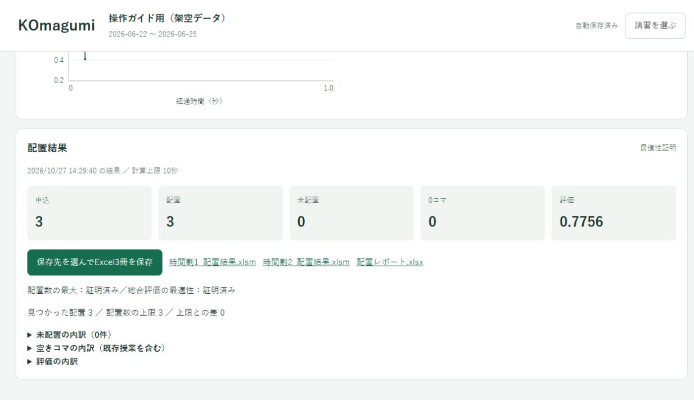

# KOmagumi

**紙の予定を入力して、講習の時間割を作るWindowsアプリ。**

生徒・講師の来られる日時と申込数をもとに、今ある授業を残して講習授業を追加します。

## ダウンロード

### [Windows版をダウンロード → KOmagumiSetup.exe](https://github.com/cijb-7724/KOmagumi-download/releases/latest/download/KOmagumiSetup.exe)

Windows 10 / 11、x64用。ダウンロード後にダブルクリックして導入します。Pythonの準備やコマンド入力は不要です。

[初めての導入手順](user/start.md) · [版ごとのダウンロード](https://github.com/cijb-7724/KOmagumi-download/releases) · [更新履歴](CHANGELOG.md)

## まずは小さなデモで試す

### [練習用データをまとめてダウンロード（ZIP）](https://github.com/cijb-7724/KOmagumi-download/raw/refs/heads/main/demo/KOmagumi-demo.zip)

**練習は4日間・生徒2人・講師2人・講習申込3コマ。** 現場の書式を保った時間割2冊（.xlsm）と、入力済みの○×です。前半は通常授業2コマ、後半は授業なしです。画面写真と同じ架空データで、Excelを自分で作らずに試せます。

**[画面を見ながらデモを動かす →](user/demo.md)**

## 読みたい説明を選んでください

| 使う人向け | 開発者・AIエージェント向け |
|---|---|
| **[操作ガイドを開く](user/README.md)** | **[技術資料を開く](technical/README.md)** |
| 初めての起動、紙の○×入力、時間割作成、保存 | 制約、数理モデル、評価関数、関数の役割、保存設計 |
| [生徒・講師・申込が変わったとき](user/changes.md) | [処理と関数の対応](technical/FUNCTIONS.md) |
| [講習の保存・再開・別PCへの移動](user/files.md) | [評価関数の厳密な定義](technical/SCORE_POLICY.md) |
| [グラフの見方・止めどき](user/run.md) | [数理モデルと最適性の範囲](technical/MATHEMATICAL_MODEL.md) |
| [困ったとき](user/trouble.md) | [AIエージェントの作業入口](AGENTS.md) |

## 使う前に

**対応書式の時間割Excelが2冊必要です。** 任意の時間割ファイルを自動認識するアプリではありません。[必要なファイル](user/start.md#prepare)をご確認ください。

アプリに実際の生徒・講師や講習データは入っていません。入力したデータは利用するPCと選んだファイルに保存します。問い合わせを公開するときは、実名・予定・講習ファイルを添付しないでください。

現在の配布版は **v0.9.1**。開発PCで導入と一連の操作を確認済みです。職場PC・会社Excel・WebView2未導入PCでの受入は未完了です。[確認状況](technical/STATUS.md)

このリポジトリは配布物と説明を公開する場所です。アプリのソースコードは非公開で管理しています。
