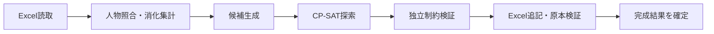

# 処理と関数の設計

[← 技術資料](README.md) · [全体の構成図](ARCHITECTURE.md)

以下のパスは**非公開の開発リポジトリ内**の位置。公開リポジトリからソースを読めるという意味ではない。v0.9.2の実装に対応する。

## 計算の流れ

## 公開する責務と入出力

| ファイル / 関数 | 入力 → 出力・責務 |
|---|---|
| `reader.py: inspect_workbook(path)` | OOXML → Inspection。名簿・日時・物理授業・セル・既存矛盾を読む |
| `bundle.py: inspect_schedules(paths)` | 2冊 → 共通Inspection。人物・時刻・日付範囲・出力先を照合 |
| `inputs.py: read_input_files(...)` | 設定・申込・可否＋名簿 → Inputs。担当・総数・PS1等を検証 |
| `inputs.py: Inputs.can_add_on(day, student)` | 期間判定に新規配置の基準日を重ね、指定日の翌日以降だけ許可。既存消化はcontains_dateで別判定 |
| `problem.py: prepare(schedule, inputs)` | Inspection＋Inputs → Problem。固定集計、担当/科目残数、候補・棄却理由 |
| `problem.py: placement_upper_bound(problem)` | 候補と残数 → 生徒別最大流の緩和上界 |
| `solver.py: solve(problem, time_limit=180, ...)` | Problem → Solution。配置数先行、複合目的、停止、最良、証明状況、推移 |
| `solver.py: metrics(problem, additions)` | 固定＋新規 → 実測値と整数点。サマリー・評価・グラフの共通値 |
| `problem.py: validate_additions(problem, additions)` | 新規案 → 違反検査。solverモデルと独立に残数・占有・PS1・ブース等を確認 |
| `writer.py: write_schedule(problem, solution, destination)` | 検証済み配置 → 元部品を保持したExcel＋保持検証結果 |
| `reports.py: solution_report(...)` | 配置・評価・検証 → 配置レポート.xlsx |
| `service.py: run(...)` | 入力一式 → 読取、探索、一時出力、検証、結果セットの確定 |
| `service.py: check_files(workbooks, input_files)` | 同じ入力 → 読取・候補生成までの検証。計算と別ルールを作らない |

## 評価の共通実装

| 関数 | 責務 |
|---|---|
| `objectives.weights_for(settings)` | 方式と重みを検証。v7/v8の編集値を保持し、旧方式は現初期値へ |
| `objectives.effective_weights(problem)` | 入力固定の適用条件により対象外を重み0にする |
| `preference_scores.basis(problem)` | 固定授業と追加残数から分母・対象日・評価対象を固定する |
| `preference_scores.measured_data(problem, additions)` | 合計時間割の占有・講習日・消化等を集計 |
| `preference_scores.points(problem, data, ops=None)` | 同じ式を整数実測とCP-SAT演算の両方へ適用。段階ごとにfloor |
| `objectives.protected_weights(problem)` | 配置係数 `10^6×有効重み合計+1`、0コマ人数の係数0 |
| `objectives.normalized_score(problem, measured)` | 同じ整数点を重み付き平均し0〜1へ。全対象なしはNone |
| `solver.gap_details(problem, additions)` | 人物×日別の既存のみ/結果の空き・該当コマを提示 |

`objective_bounds` の補助的な範囲と、現行9項目の正規化定義を混同しない。評価方式は [SCORE_POLICY.md](SCORE_POLICY.md) と `preference_scores.py` で追う。

## 保存と画面

| 境界 | 責務 |
|---|---|
| `WorkStore` | revision、原子的更新、入力履歴、人物/日時引継ぎ |
| `CourseLibrary` / `WorkLock` | 講習ごとの分離、アーカイブ取込、同時編集拒否 |
| `courses.export_archive(store)` | ○×・設定を軽量 .komagumi へ。Excelと結果を含めない |
| `documents.write_document(path, raw, expected)` | 直前SHA照合、同名新規作成の拒否、一時ファイルからの確定 |
| `documents.open_document` / `save_document` | 文書と内部講習の紐付け、自動保存、外部変更保護 |
| `results_store.py` / `result_cache.py` | 最新完成結果を設定から分離して保存、正常確定後の更新・限定整理 |
| `web_app.py` | localhost API、入力版固定、ジョブ・停止・進捗とAPIトークン |
| `gui/app.js` / `bridge.js` | 保存待ち、入力・設定とAPIの接続、停止中の操作抑止 |
| `prototypes/availability_intake` / `teacher_availability` | 現行の紙転記UI。名前がprototypesでも正本として再利用 |

手動停止は停止通知→solver停止→最良確定→独立検証→Excel出力。ウィンドウ終了は入力保存と計算終了を待つ。Promise callback上でworkerをjoinして画面を停止させない。

変更時は、役割が隣接する処理も確認する。例えば評価変更をグラフ側だけへ、期間変更を表示側だけへ実装しない。[変更とテストの対応](TESTING.md)
