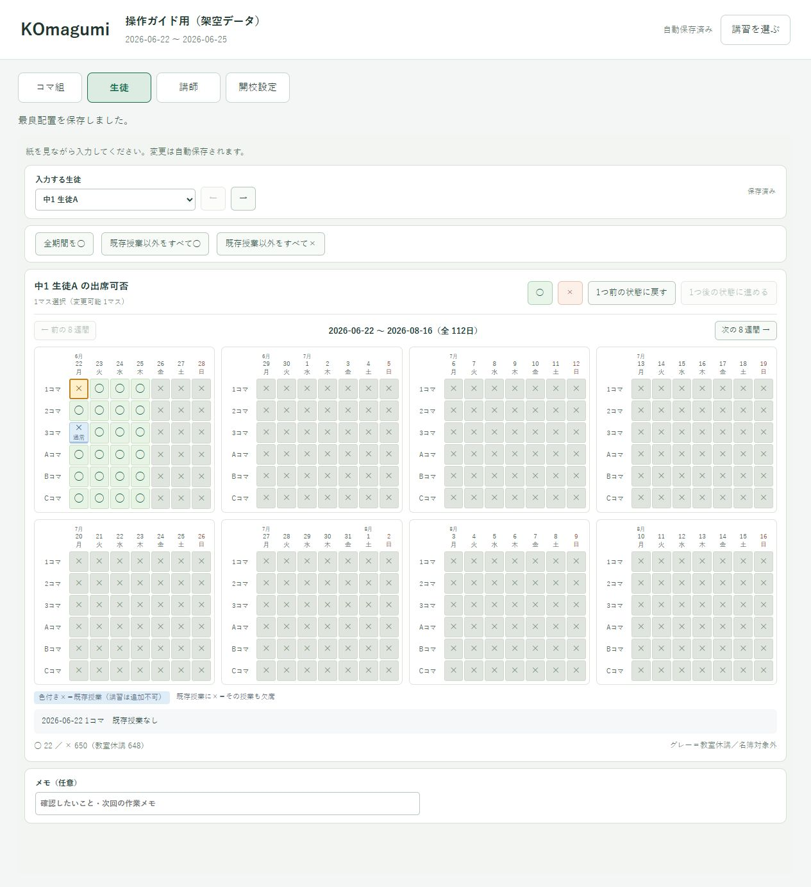
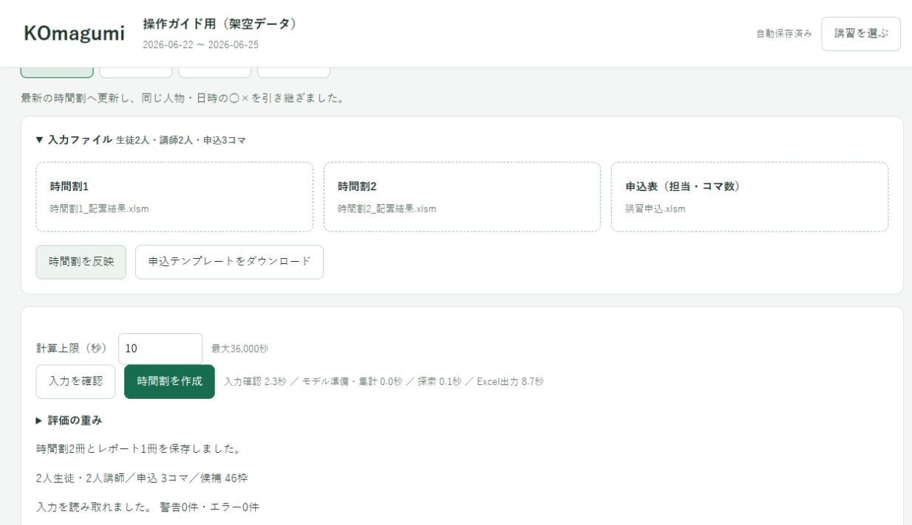
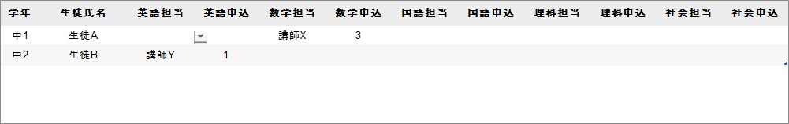
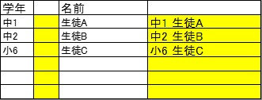
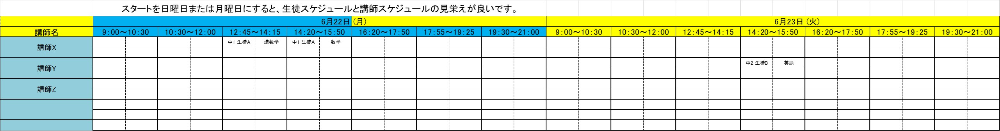
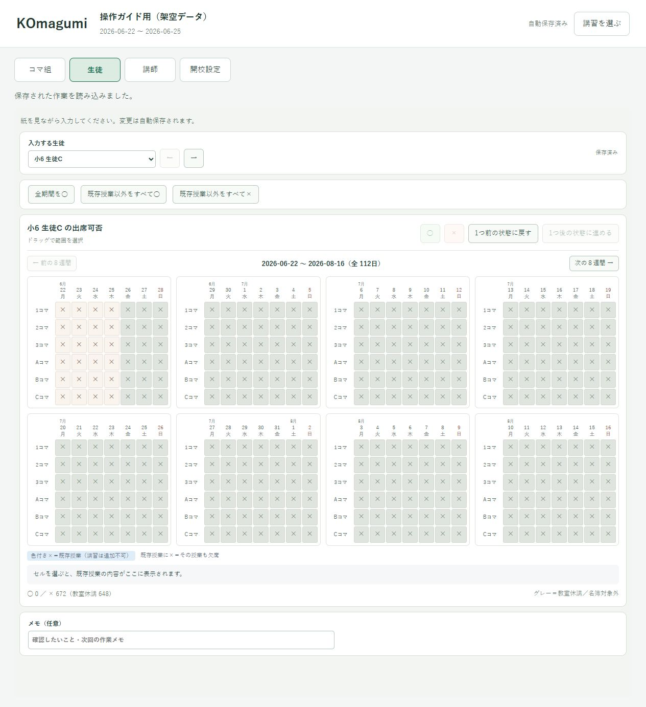
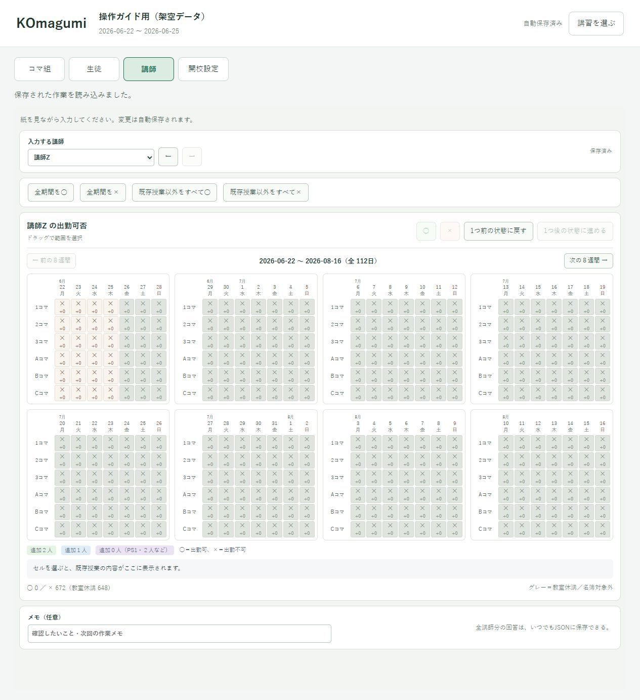

# 予定・Excel・申込・名簿が変わったとき

[← 操作ガイド](README.md) · [保存・PCの移動](files.md) · [デモの最初から](demo.md)

## まず、変わったものを選ぶ

**同じ講習なら、いつもの .komagumi を開いたまま更新します。「新規作成」は押しません。**

| 変わったもの | 行う操作 |
|---|---|
| 生徒・講師の予定だけ | アプリの「生徒」「講師」で○×を変更 |
| 休講・使用コマ・基本期間 | 「開校設定」を変更 |
| 既存授業、時間割側の名簿 | 最新の時間割2冊を選び「時間割を反映」 |
| 申込数、担当、PS1だけ | 最新の申込Excelを読み直す |
| 生徒や講師が増えた | 時間割の名簿→反映→新しい人の○×→申込の順に更新 |
| 次の季節の講習 | 「新規作成」で別の講習を作る |

## 生徒・講師の予定だけ変わった

例：生徒Aが6/22の1コマに来られなくなった場合です。

1. いつもの .komagumi を開きます。
2. 同じPCで前回のExcelが読み込まれていれば、そのまま「生徒」へ進みます。**毎回Excelを選び直す必要はありません。**
3. 生徒Aを選び、該当のセルを選択して「×」を押します。講師の予定変更なら「講師」で同じように操作します。
4. 「自動保存済み」を確認します。間違えたら「1つ前の状態に戻す」で戻せます。
5. 再計算する場合は「コマ組」→「入力を確認」→「時間割を作成」と進みます。

`.komagumi`だけを別PCで開いた場合も○×自体は編集できます。ただし、**既存授業の表示と再計算にはExcelが必要**です。別PCでは先に最新の時間割2冊と申込を読み込んでから編集すると、授業との重なりも確認できます。

○×の変更だけで、配置済みの授業は移動・削除されません。確定済み授業に来られなくなった場合は、職員が時間割Excelを修正します。

## 時間割Excelを更新した・不足分だけ追加したい

例：職員が授業を移動した、または前回の出力へ不足分を追加したい場合です。

1. 必要な前回結果をExcelで保存しておきます。
2. **最新の時間割2冊**をExcelで保存し、閉じます。
3. 今の講習の「入力ファイル」で2冊を選び、「時間割を反映」を押します。
4. 引継ぎの表示、人数・日付、代表の生徒・講師の○×を確認します。
5. 申込が同じなら、その申込を再作成する必要はありません。申込も変わった場合だけ最新版を読み直します。
6. 「入力を確認」から再計算します。

**今回読み込んだ授業はすべて固定です。** 前回出力した「講」の授業も動かさず、不足分だけを追加します。前回の入力Excelをそのまま使うと、前回の新規配置はまだ固定授業に含まれません。確定した時間割を続けて使いたいときは、出力の2冊を選んでください。

同じ人物・日付・コマの○×は引き継がれます。Excelの編集内容は、アプリに勝手には反映されません。

## 申込数・担当・PS1だけ変わった

例：生徒Aの数学が2コマから3コマへ増えた場合です。

1. 講習申込Excelの数量を変更して保存します。
2. 同じ講習の「申込表（担当・コマ数）」から、その最新版を読み直します。
3. 申込合計と「入力を確認」の結果を確認します。時間割が変わっていなければ、2冊を選び直す必要はありません。

**数量は残数ではなく契約総数です。** 10コマ契約で6コマ配置済みなら10のまま、追加契約で合計12なら12にします。アプリが既存講習の消化を差し引きます。通常授業は講習の消化には入りません。

担当が変わった場合は、担当別の数量も直します。講師Aの不足を講師Bへ自動で移すことはありません。減数で既存授業が超過しても自動削除はせず、警告を確認してExcelで調整します。

## 講習の途中で生徒・講師が増えた

例：小6 生徒Cと講師Zが増えた場合です。

### 1. 時間割の名簿へ登録する

生徒は「学年と名前を結合するシート」の**空き行**に、A列の学年とC列の氏名を入力します。B列の区切りとD列の数式は変更しません。

講師は「講習スケジュール(入力用)」の**既存の空いた講師欄**へ氏名を入力します。上下2人分の枠・結合・補助計算を保ち、講師行を新しく挿入する操作は避けます。

**両方の期間で配置する人は2冊とも登録**して保存します。片方にだけ登録した人は、その冊子の枠にだけ配置できます。生徒は学年・氏名、講師は氏名を、2冊と申込Excelでそろえてください。

### 2. アプリに反映し、新しい人の○×を入力する

「入力ファイル」で最新2冊を選び「時間割を反映」を押します。既存の人の共通日時の○×は残ります。「生徒」で生徒C、「講師」で講師Zを選び、紙の予定を入力します。

名簿に追加しただけでは全期間○になりません。新しい生徒は×、新しい講師は既存授業のあるコマだけ○が初期値です。未提出の紙を「全期間○」として扱わないでください。

### 3. 申込Excelも更新する

「選択肢」に生徒・講師を追加し、「講習申込」に担当と契約総数、必要なら「PS1対象」を記入して保存します。名簿の自動反映にはテンプレートのマクロを許可できるExcel環境が必要です。

アプリで申込Excelを読み直し、「入力を確認」を押します。**申込表に名前を追加しただけでは、時間割側の名簿には登録されません。**

## 改名・学年変更・退塾・担当交代

時間割2冊と申込Excelを一致させます。改名・学年変更は同じ人物と対応できず、○×を引き継げない場合があります。表示を確認し、紙と照合して入力します。同姓同名を推測で混ぜないでください。

既存授業のある人を削除・交代させるときは、先にExcelで授業と契約を確認します。名前の削除だけで授業が自動的に消えたり、別の人へ移ったりはしません。
