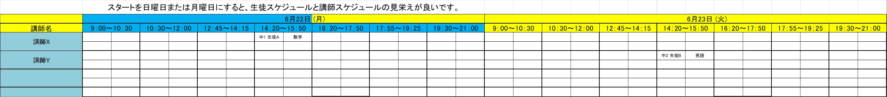
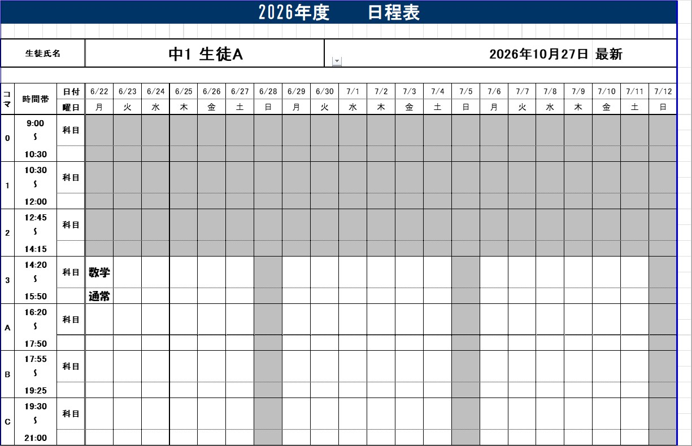
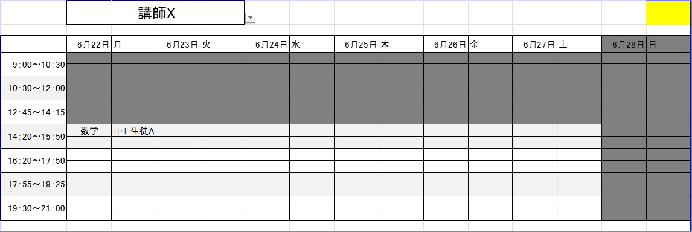
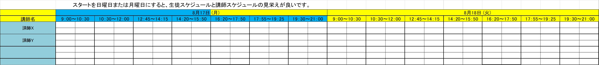
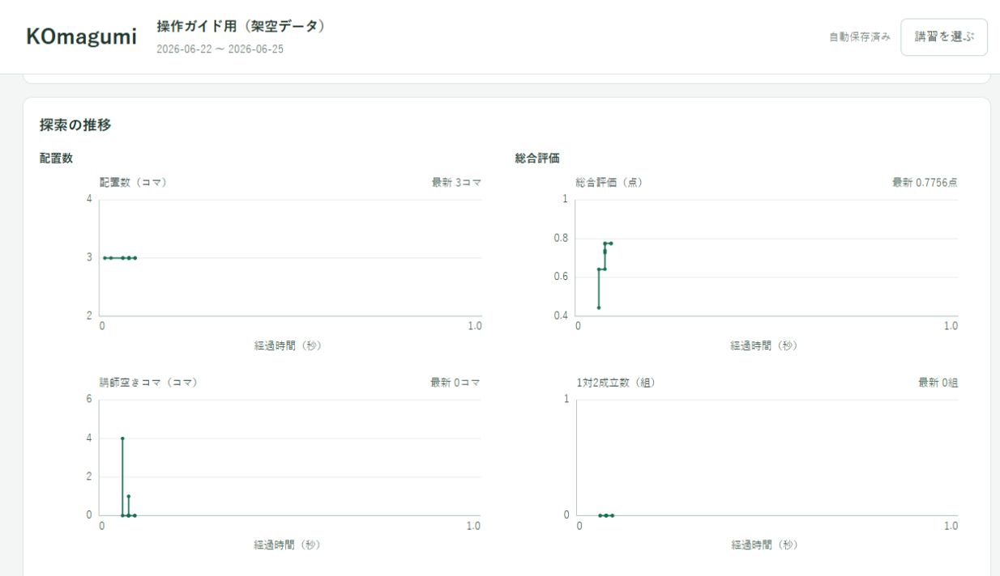
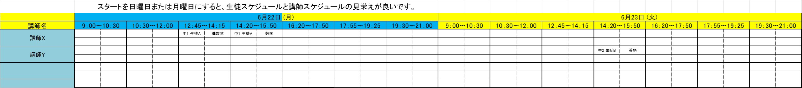
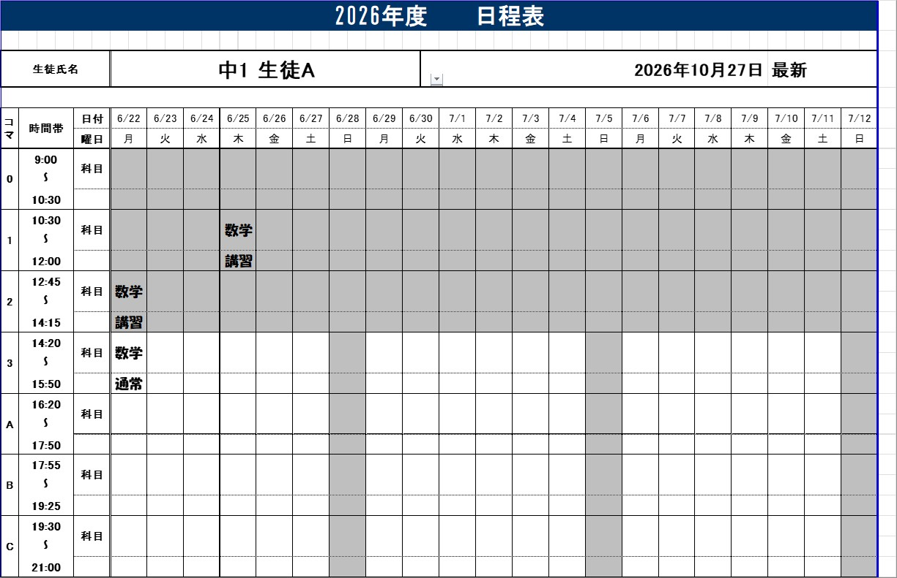
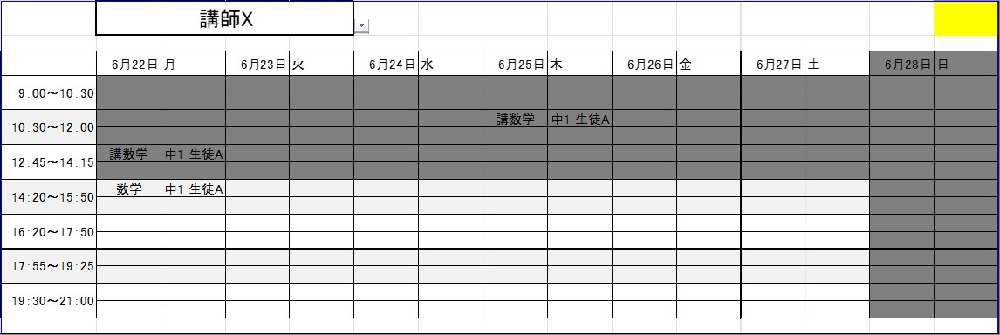

# デモで試す

[← 操作ガイド](README.md) · [予定・名簿が変わったとき](changes.md)

**現場と同じ書式のExcelで、通常授業を残して講習を追加する練習です。** 氏名・担当・申込・○×は架空です。時間割は実際の帳票を複製し、数式・色・セル幅・結合・マクロを保っています。

## 1. ダウンロードして展開する

**[練習用データ一式（ZIP）をダウンロード](https://github.com/cijb-7724/KOmagumi-download/raw/refs/heads/main/demo/KOmagumi-demo.zip)**

ZIPを右クリック→「すべて展開」で展開します。ZIPの中から直接開かず、展開先のファイルを使います。

| ファイル | 内容 |
|---|---|
| 時間割1.xlsm | 6/22〜8/16の現行帳票。生徒A/Bの通常授業が合計2コマ |
| 時間割2.xlsm | 8/17〜10/11の同じ帳票。教室全体で既存授業0コマ |
| 講習申込.xlsm | 生徒Aの数学2コマ・講師X、生徒Bの英語1コマ・講師Y（PS1） |
| 練習用.komagumi | 記入済みの○×・開校・設定 |
| はじめに.txt | 同梱の短い手順 |

生徒は中1 生徒A・中2 生徒B、講師は講師X/Yです。**練習で使うのは2026/6/22〜6/25の4日間**。ほかの日は教室を休講にしてあります。帳票自体は8週間×2冊のままで、後半には今回の練習で新規配置もしません。

## 2. 入力Excelを先に見る

時間割1をExcelで開きます。入力するシートは「講習スケジュール(入力用)」です。

- 6/22の3コマ：生徒A・講師X・数学
- 6/23の3コマ：生徒B・講師Y・英語

どちらも通常授業で、「講」の付いた授業はまだありません。

「生徒スケジュール」で生徒Aを選ぶと通常の数学だけ、「講師用」で講師Xを選ぶとその担当授業だけを確認できます。黄色い計算欄へ直接入力しないでください。

時間割2は、生徒・講師の名簿はありますが、授業欄は空です。

確認後はExcelを閉じます。デモを計算するだけなら、Excelのマクロを実行する必要はありません。

## 3. 講習ファイルとExcelを読み込む

KOmagumiを起動し「.komagumi を開く」で **練習用.komagumi** を選びます。すでに別の講習を開いている場合は、上部の「講習を選ぶ」から進みます。

「コマ組」→「入力ファイル」で次の順に操作します。

1. 「時間割1」で **時間割1.xlsm** を選ぶ。
2. 「時間割2」で **時間割2.xlsm** を選ぶ。
3. 「時間割を反映」を押す。
4. 「申込表（担当・コマ数）」で **講習申込.xlsm** を選ぶ。
5. **生徒2人・講師2人・申込3コマ**を確認する。

## 4. ○×と開校を確認する

「生徒」で生徒Aを選びます。6/22の3コマには「通常」があり、新しい授業は重ねられません。「講師」で講師Xの同じコマを見ると、追加できる人数は「+1」です。

使う4日間の○×は入力済みなので、最初は変更せず計算できます。後で予定を変更する練習は [○×だけ変わったとき](changes.md#availability)を参照してください。

## 5. 計算してExcel3冊を保存する

「コマ組」へ戻り「入力を確認」→「時間割を作成」を押します。計算上限は10秒に設定済みです。上限より早く完了する場合もあります。

**申込3・配置3・未配置0**を確認し、「保存先を選んでExcel3冊を保存」から新しい「デモ結果」フォルダーへ保存します。

## 6. 通常授業と講習を見比べる

出力した時間割1をExcelで開きます。入力してあった通常授業2コマは同じ位置に残り、**「講数学」「講英語」が合計3コマ追加**されます。PS1の予約表示も確認します。配置位置は計算条件・アプリの版等で変わる場合があります。

画像は帳票の一部を拡大しています。追加された3コマ全体は、Excelの日付を横へ進めるか、生徒別・講師別シートで確認できます。以下も、Excelで再計算した実際の帳票です。

同じ生徒・講師を選んで、入力前の時間割と見比べます。

出力した時間割2は今回も空のままです。元の入力Excelは変更されません。次に不足分を追加するときは、この**出力時間割2冊**を最新の入力として読み込むと、今回の配置も固定して扱います。

## 練習をやり直す・本番へ進む

○×は開いている練習用.komagumiに自動保存されます。最初からやり直すときは、ZIPを**別フォルダーへ**展開します。

本番は「新規作成」で別の講習を作ります。デモの名前だけ変えて本番に使い回さないでください。

**[予定・申込・生徒や講師が変わったとき →](changes.md)**
