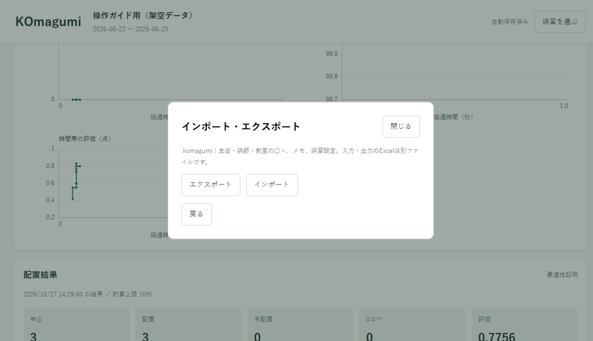

# 講習の保存・再開・PCの移動

[← 操作ガイド](README.md) · [データが変わったとき →](changes.md)

## 覚えるのは2種類

| 種類 | 入っているもの | 保存方法 |
|---|---|---|
| **.komagumi** | 生徒・講師・教室の○×、メモ、講習名・期間・重みなど | アプリが自動保存 |
| **Excel** | 名簿・既存授業、申込・担当・PS1、出来上がった結果 | Excelや結果保存ボタンで保存 |

`.komagumi` に、入力Excelや出来上がった時間割は入りません。**このファイル1個だけを持っていっても、別PCで計算はできません。**

## いつも終了するとき

1. 画面上部が「自動保存済み」になるのを確認します。
2. 結果がある場合は、必要なExcel3冊を保存します。
3. アプリの×で閉じます。

○×を保存するために毎回エクスポートする必要はありません。通常終了時もアプリが保存を待ちます。電源を切る前に、アプリを閉じてください。

## 続きを開くとき

1. KOmagumiのアイコンを開きます。
2. 「.komagumi を開く」で、前回の講習ファイルを選びます。
3. 講習名・期間が正しいことを確認します。

同じPCなら、前回読み込んだExcelの作業コピーを再利用できます。ただし、**Excelで手直しした内容は自動では反映されません。** 修正後のファイルを読み込んでください。

## ○×だけ直す場合

同じPCで前回のExcelコピーを使える場合は、講習を開いて「生徒」「講師」からそのまま変更できます。毎回のExcel再読込は不要です。時間割を編集した場合は、最新版を「時間割を反映」で読み直してください。

.komagumiだけでも○×は編集できますが、既存授業の表示と計算はExcelの接続後に行います。[変更別の画面付き手順](changes.md)

<a id="folder"></a>

## まとめて保管する

例として、1講習を次のようにまとめます。フォルダー名は自由です。

```text
2027年 冬期講習/
  冬期講習.komagumi
  入力/
    時間割1.xlsm
    時間割2.xlsm
    講習申込.xlsm
  結果_12月01日/
    出力された時間割1.xlsm
    出力された時間割2.xlsm
    配置レポート.xlsx
```

結果の時間割の拡張子は入力によって異なります。**別の保存場所へは、この講習フォルダーごとコピー**すれば、○×・入力・結果をまとめて保管できます。コピーはアプリを閉じてから行ってください。

`.komagumi` にも人物名や予定が入ります。Excelと同じく教室で決めた保管先を使い、公開ページや公開の問い合わせへ添付しないでください。

## 別のPCで続きを使う

1. 移動先へKOmagumiをインストールします。
2. 講習フォルダーを、移動先のPCへコピーします。
3. コピー先の `.komagumi` をアプリから開きます。
4. 「入力ファイル」で時間割2冊を選び「時間割を反映」を押します。
5. 申込Excelも選びます。
6. 人数・日付と○×を確認してから「入力を確認」へ進みます。

同じ人物・日時の○×は引き継がれます。移動先のPCに、以前の計算結果が表示されることは前提にしないでください。結果は外部のExcelで持ち込みます。

## インポートとエクスポート

どちらも「講習を選ぶ」→「インポート・エクスポート」にあります。



| 操作 | 使う場面 |
|---|---|
| **エクスポート** | 現在の○×・設定を、別名の `.komagumi` へコピーする |
| **インポート** | 受け取った `.komagumi` を講習として取り込む |
| **.komagumi を開く** | 選んだファイルへ自動保存しながら編集する、通常の再開 |

正常な講習からエクスポートしただけでは、普段の自動保存先は元のファイルのままです。コピーした方を編集したいときは、そちらを開き直します。

<a id="save-error"></a>

## 「保存できません」と出たら

入力中のアプリを閉じずに、エクスポートで**別のファイル名**へ保存します。移動・削除・外部変更を検知した場合、このPCに保持している入力を別名で救出できます。保存後、新しい `.komagumi` を開き直して確認します。

入力値にエラーがある場合は、先に表示された項目を修正します。内部のJSONやフォルダーを探して削除する必要はありません。

## 次の講習を始める

「講習を選ぶ」→「新規作成」で別の講習ファイルを作ります。前の講習はそのまま残ります。新しい講習では、新しい期間・Excel・紙の予定を入力してください。
