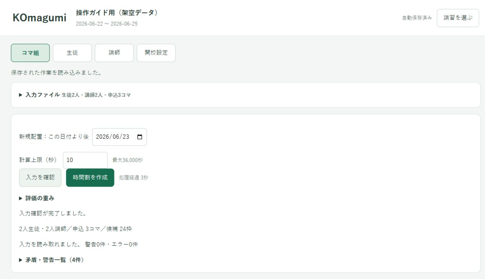
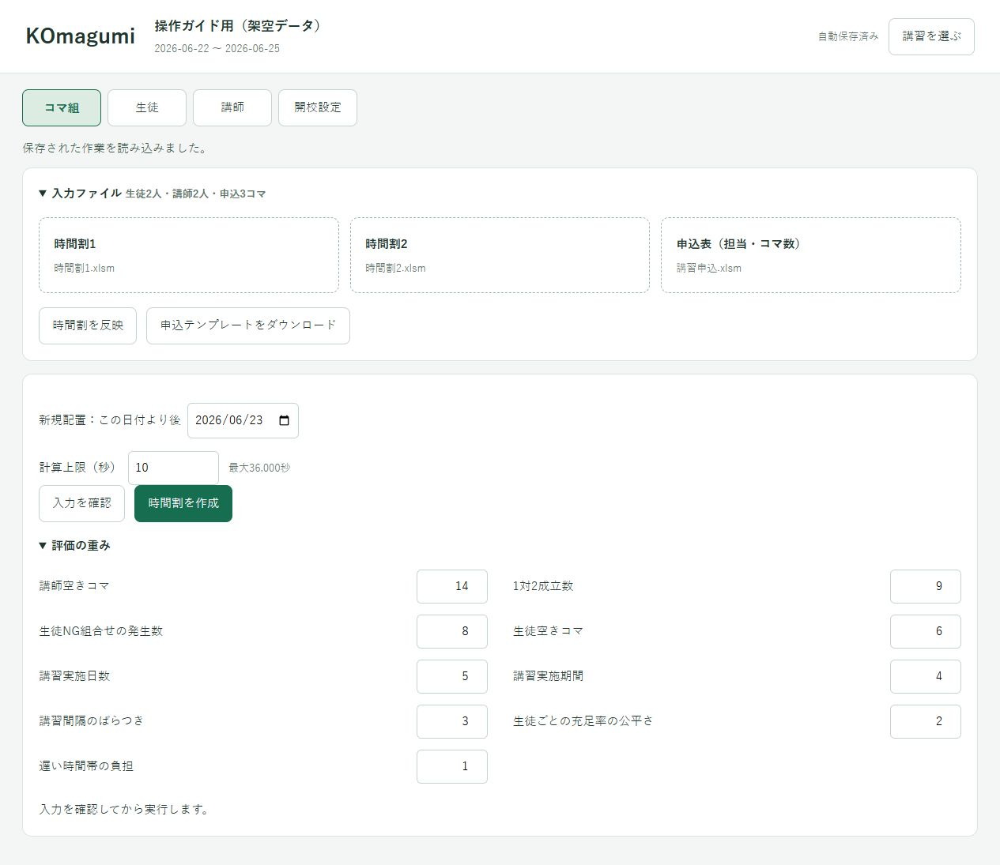

# 時間割を作る・グラフを見る

[← 操作ガイド](README.md) · [結果を保存する →](files.md)

## 1. 入力を確認する

必要なら「新規配置：この日付より後」を指定します。指定日の翌日からだけ追加し、既存授業と○×は保ちます。空欄なら日付による追加制限はありません。中学生の基本期間などの条件も適用します。この設定は.komagumiへ自動保存されます。

「コマ組」で「入力を確認」を押します。

**エラー**があれば、表示された人・ファイル・セルを直してから再確認します。**警告**は既存授業の矛盾など、人が確認する事項です。警告とエラーを同じ意味に読まないでください。

## 2. 計算を始める

「計算上限（秒）」を決めて「時間割を作成」を押します。初期値は180秒です。これは探索に使う時間の上限で、準備やExcel保存の時間は別にかかります。

計算中は入力を変更できません。入力を直す場合は、途中停止して結果の保存処理が終わってから編集します。

## 3. 配置数と総合評価を見る

| グラフ | 見るポイント |
|---|---|
| **配置数** | 申込のうち何コマを配置できたか。まずこちらを見る |
| **総合評価** | 同じ配置数での時間割の良さ。空きコマなど9項目のまとめ |
| **講師・生徒の空きコマ** | 少ない方がよい。授業と授業の間の空きを数える |

配置1コマの増加を、総合評価の改善より優先します。総合評価 **0.9は、申込の90％を配置した意味ではありません。** 配置の達成状況は配置数・未配置数で確認します。

空きコマは既存授業と新規授業の合計です。例：A・Cに授業がありBが空きなら1コマ。最初の授業より前と最後の授業より後は数えません。グラフの縦軸は自動で拡大されるので、線の高さだけでなく目盛りと単位も見てください。

[11グラフと結果をまとめて見る](../assets/screenshots/08-results.jpg)。この写真はごく小さなデータなので、1秒未満で探索が終わっています。

## 4. いつ止めるか

**配置数が落ち着き、総合評価も横ばいになってきたら「停止して最良配置を保存」で止める**のが、日常運用の目安です。上限まで必ず待つ必要はありません。

横ばいでも、これ以上よくならないと証明されたとは限りません。未配置が残る場合は、配置上限との差やレポートの理由も確認します。点数を1.0にするまで待つ必要はありません。

停止後は、くるくるする表示が消えて結果が出るまで待ちます。Excelを作成・検証しているので、この間はアプリを閉じないでください。

## 5. Excel3冊を保存する

1. 結果が出たら「保存先を選んでExcel3冊を保存」を押します。
2. 今回の結果用のフォルダーを選びます。
3. **時間割2冊と配置レポート1冊**が保存されたことを確認します。
4. レポートの「サマリー」「未配置」「矛盾と警告」と、各時間割を確認します。
5. 配布・連絡前に職員が最終確認します。必要な手直しはExcelで行います。

未配置があっても結果を保存できます。○×や担当が本当に正しいか、残りをどの日時へ調整できるかをレポートで確認します。

## 評価の重みを変えたいとき

「評価の重み」で数字を変更します。大きいほど重視し、0ならその項目を評価から外します。講師の空きを優先したい場合は「講師空きコマ」を大きくします。変更は次の計算から反映されます。

重みを変えた前後の総合点は、同じ物差しの点数ではありません。まず配置数、その後に空きコマなど実際の数で確認してください。

## もう一度計算するとき

秒数変更・入力確認だけで、完成結果は消えません。次の計算が正常に完了すると最新結果が切り替わるので、**比較したい前の結果は先にExcelで保存**します。

同じ条件でも探索の進み方が変わるため、別の計算で長時間実行した方が必ず高得点になるとは限りません。同じ計算の途中では、その計算内で見つけた最良の結果を保存します。

出力時間割を次回の入力にすると、その中の授業はすべて固定になります。追加位置を最初から考え直したい場合と、不足分だけ追加したい場合を区別してください。[再計算の手順](changes.md#re-run)
