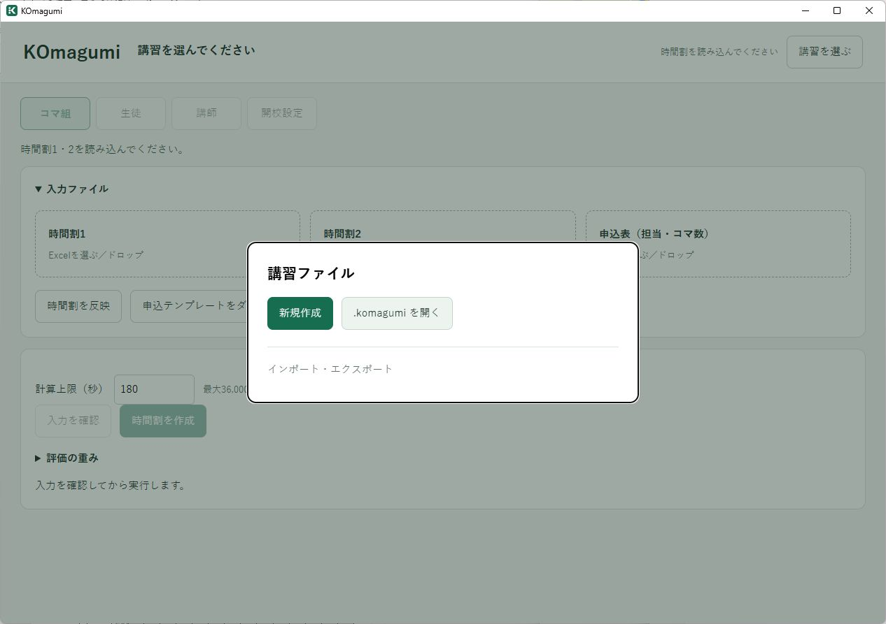
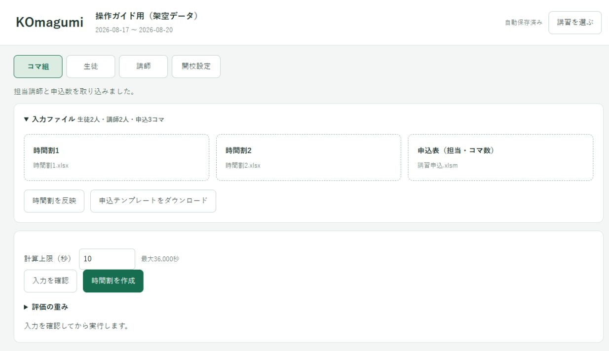
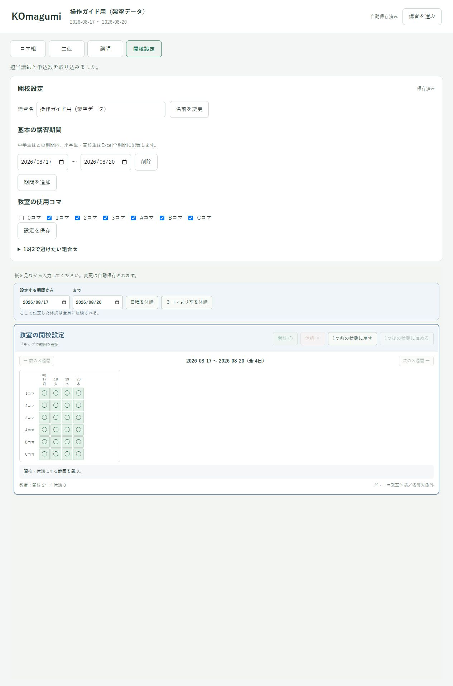
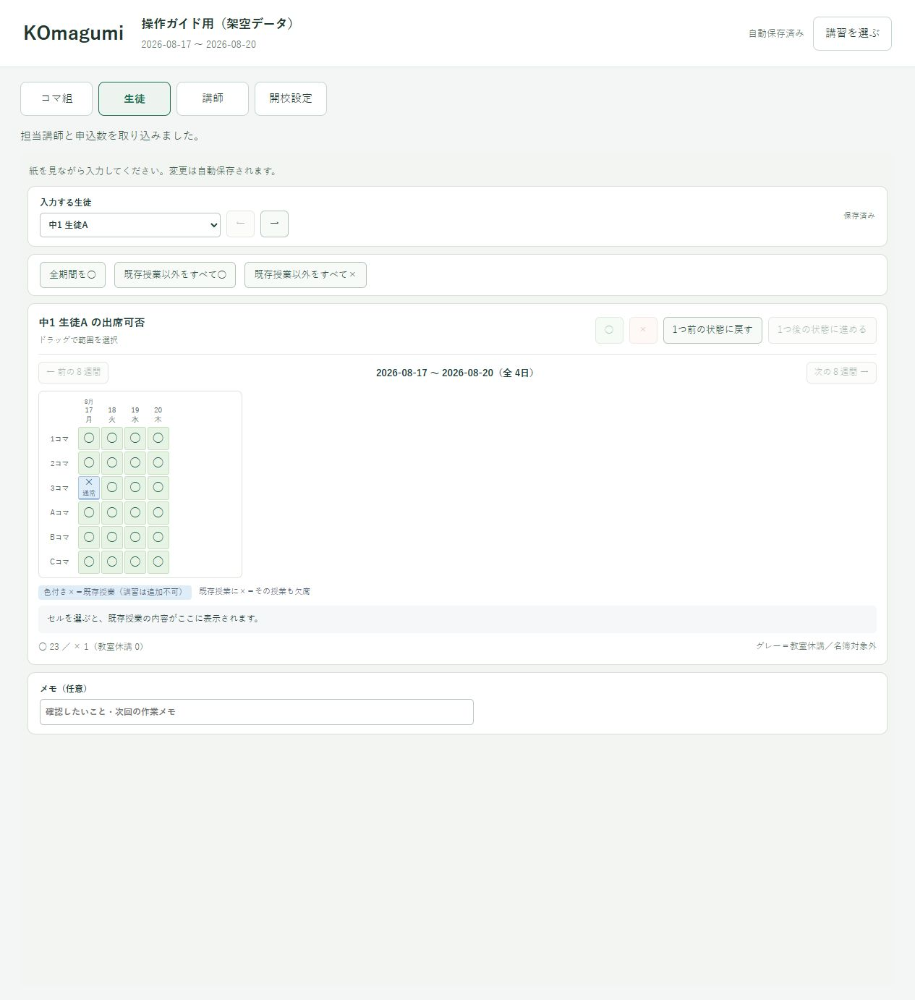
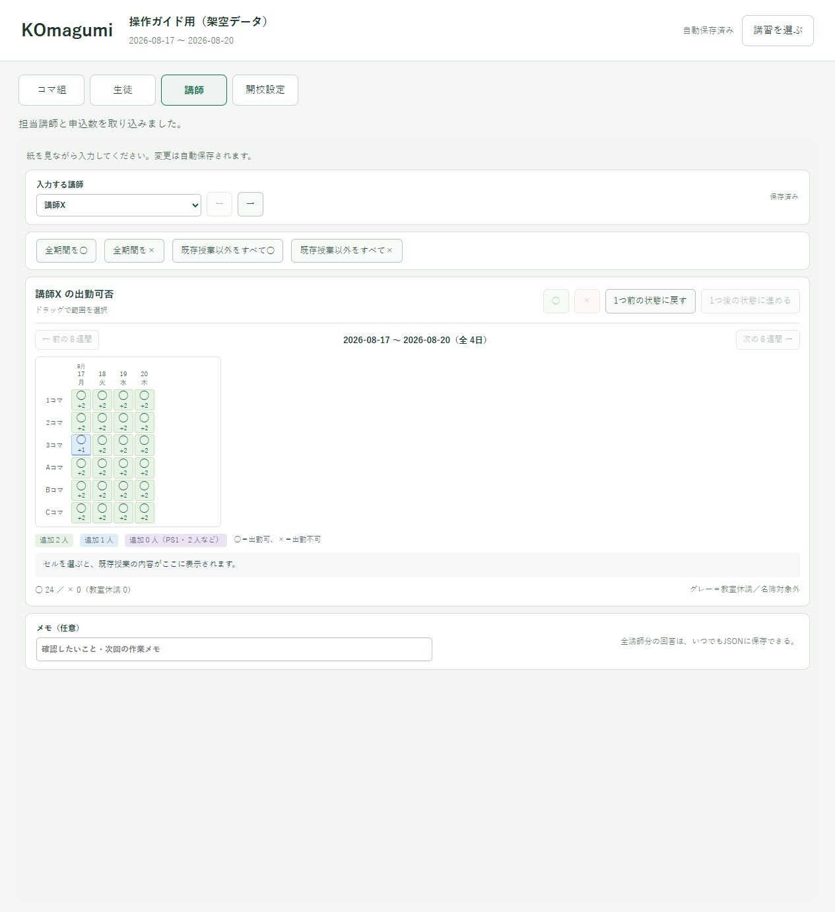

# 初めて使う

[← 操作ガイド](README.md) · [次：時間割を作る →](run.md)

## 1. インストールする

1. **[KOmagumiSetup.exeをダウンロード](https://github.com/cijb-7724/KOmagumi-download/releases/latest/download/KOmagumiSetup.exe)**します。
2. ダウンロードした `KOmagumiSetup.exe` をダブルクリックします。
3. 「インストール」→「完了」と進みます。
4. 次回から、デスクトップの緑色の **KOmagumi** アイコンをダブルクリックします。

画面表示に必要なWebView2は、セットアップが確認して必要なときだけ導入します。Pythonのインストール、PATHの設定、黒い画面へのコマンド入力は不要です。ダウンロード済みのセットアップはネット接続のないPCにも持ち込めます。

会社の制限やWindowsの警告で進めないときは、表示内容を管理者に確認してください。[起動できないとき](trouble.md#startup)

## 用意するもの

| 用意するもの | 何に使うか |
|---|---|
| 時間割Excel **2冊**（.xlsx / .xlsm） | 名簿、日時、すでに決まった授業 |
| 講習申込Excel **1冊** | 生徒ごとの科目、担当講師、契約したコマ数、PS1 |
| 生徒・講師から集めた紙の予定 | 画面の○×へ入力 |

時間割は「講習スケジュール(入力用)」「学年と名前を結合するシート」等を持つ対応書式を使います。別の教室の独自書式は、そのまま読めるとは限りません。申込表はアプリからダウンロードするテンプレートを使います。

## 2. 講習を作る

1. 起動画面で「新規作成」を押します。
2. 講習名を入力します。例：`2027年 冬期講習`。
3. 保存する場所と `.komagumi` ファイル名を決めます。

講習ごとにフォルダーを1つ作り、講習ファイルとExcelを同じフォルダーにまとめると、後で探しやすくなります。[フォルダー例](files.md#folder)

## 3. 時間割を読み込む

1. 「コマ組」→「入力ファイル」を開きます。
2. 「時間割1」「時間割2」をそれぞれ押し、対応するExcelを選びます。
3. 「時間割を反映」を押します。
4. 生徒・講師の人数と、表示された日付を確認します。

既存授業を移動・削除する計算はしません。Excelの授業は固定したまま、空いている場所へ追加します。

## 4. 講習期間と教室の開校を決める

「開校設定」で基本の講習期間、使うコマ、開校・休講を設定します。日曜・祝日など実際に授業をしない日時は休講にします。0コマを使う場合も、ここで有効にします。

中学生の新規授業は基本期間内に入ります。小学生・高校生は時間割Excelの日付範囲内で配置され、基本期間外の減点はありません。

## 5. 紙を見て○×を入力する

「生徒」「講師」で人を選び、来られる日時を○、来られない日時を×にします。範囲をドラッグしてまとめて変更でき、間違えた操作は「1つ前の状態に戻す」で戻せます。

| 紙の記入方法 | 読み取り方 |
|---|---|
| ×だけ書いてある | ×以外は○ |
| ○だけ書いてある | ○以外は× |
| ○×が混在して一部無印 | 無印は× |
| 受け取った紙が全く無印 | 全て○ |

**紙が未提出の人を、全て○にしないでください。** 斜線やメモも含めて紙の内容を確認します。初期状態は生徒が×、講師は既存授業のあるコマだけ○です。

生徒のコマに既存授業があれば、新しい授業を重ねられません。講師の○は「出勤できる」という意味で、すでに満席なら追加は入りません。

## 6. 申込表を用意する

1. 「申込テンプレートをダウンロード」で `.xlsm` を保存します。中の名前は仮名です。
2. Excelで開き、このテンプレートのマクロを有効にします。会社の制限で許可できないときは管理者へ確認します。
3. 「選択肢」で、生徒・講師を時間割Excelと同じ学年・氏名にします。生徒行の挿入・改名・並べ替えはここで行います。
4. 「講習申込」で科目ごとの担当と申込数を入力します。**すでに配置した分を含む契約総数**を入れます。
5. 1対1契約は「PS1対象」に生徒・科目を登録します。対象がいなければ空欄のままで構いません。
6. 保存してから、アプリの「申込表（担当・コマ数）」で読み込みます。

名簿の編集は「選択肢」から行うと、記入済み数量が同じ生徒に追従します。新しく名前を追加しても、数量が勝手に入ることはありません。

準備できたら **[時間割を作る →](run.md)** へ進んでください。
